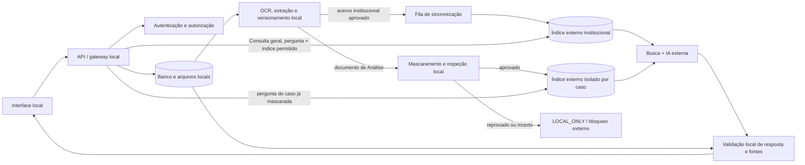

# Arquitetura de IA externa por acervo e análise protegida

**Data:** 20/10/2026  
**Status:** Consulta institucional implementada com ativação explícita; Análise externa permanece bloqueada até a validação da barreira de privacidade.
**Objetivo:** retirar da VM a geração e a recuperação semântica que podem aumentar a latência, sem misturar o acervo institucional com os documentos sensíveis de Análise.

## Decisão

O sistema terá duas rotas externas distintas, sempre mediadas pelo backend local:

1. **Acervo institucional:** documentos liberados em Documentos, entendimentos aprovados e conteúdo final da Revisão podem ser sincronizados com um índice externo persistente. A Consulta chama diretamente a busca e a geração externas; não faz busca vetorial local a cada pergunta.
2. **Análise de processo:** documentos anexados a um caso nunca entram no índice institucional compartilhado. O original permanece na VM. OCR, extração e ocultação de dados são feitos localmente; somente uma derivação que passe por uma barreira de privacidade pode seguir para análise externa. Para vários documentos, recomenda-se um índice externo isolado por caso, contendo apenas as derivações liberadas, reutilizado nas perguntas daquele caso e excluído quando o caso for encerrado.

O banco e os arquivos locais continuam sendo a fonte oficial, o controle de acesso e o histórico. A IA externa **não recebe credenciais nem conexão ao banco**. No fluxo institucional, ela pesquisa um acervo externo sincronizado. No fluxo de Análise, ela pesquisa uma cópia externa isolada e mascarada. Portanto, o segundo fluxo ainda transfere conteúdo derivado para fora da VM; ocultar campos é uma proteção, não uma autorização automática.

## Separação dos acervos

| Classe | Conteúdo | Índice externo | Escopo e retenção |
| --- | --- | --- | --- |
| `INSTITUCIONAL_LIBERADO` | Normas, documentos da aba Documentos, entendimentos do cartório e respostas finais da Revisão considerados não sensíveis e liberados | Índice persistente compartilhado da serventia | Apenas material aprovado/publicável. Atualização e exclusão sincronizadas com o banco local. Rascunhos, comentários de revisão e dados de usuários ficam fora. |
| `CASO_SENSIVEL` | Anexos, fatos, mensagens e resultados privados da aba Análise | Índice externo isolado por caso, somente com derivações sanitizadas e liberadas | Nunca pesquisar junto com o acervo institucional nem com outro caso. Excluir o índice quando o caso for encerrado e reconciliar exclusões pendentes. |
| `LOCAL_ONLY` | Conteúdo que não possa ser efetivamente anonimizado, que falhe na inspeção, ou cujo envio não esteja autorizado | Nenhum | Permanece na VM; não há fallback que envie conteúdo original. |

O navegador nunca escolhe um índice externo nem envia seu identificador. O backend determina o acervo após autenticar o usuário, validar o papel e verificar o acesso ao documento ou caso.

## Componentes

1. **Interface local:** envia a pergunta, o caso selecionado e os arquivos; exibe fila, progresso, citações e falhas. Não possui chave do provedor.
2. **API local/gateway:** autentica, autoriza o escopo, aplica limites e escolhe a rota. Guarda a chave externa em secret do servidor, não no Git, navegador ou logs.
3. **Arquivo e banco local:** guardam originais, texto extraído, governança, versão/hash, histórico, vínculo documento/página/trecho, ACL e mapa de pseudônimos.
4. **Pipeline local de ingestão:** valida arquivo, faz OCR, preserva páginas, extrai texto, classifica e calcula hash. Para Análise, executa também a ocultação antes de qualquer saída.
5. **Sincronizador institucional:** mantém o índice externo aprovado coerente com o banco, por fila durável e operações idempotentes.
6. **Gerenciador de índice por caso:** cria/atualiza um índice isolado com derivações liberadas, guarda o identificador externo somente no backend e agenda a exclusão no encerramento.
7. **Provedor externo:** realiza recuperação semântica e geração. Devolve texto e referências; a decisão profissional permanece humana.
8. **Validador local de resposta:** resolve IDs opacos de fontes em documentos/páginas locais e rejeita referências inexistentes, fora do escopo ou sem trecho correspondente.

## Consulta ao acervo institucional

### Inclusão e atualização

1. O arquivo é recebido e armazenado primeiro na VM; OCR, extração, governança e aprovação continuam no fluxo atual.
2. Só documentos `PRONTO`, liberados e aprovados entram na fila externa. Para entendimentos e Revisão, entram somente versões finais liberadas. Rascunho ou comentário não é indexado.
3. A fila envia o conteúdo elegível e metadados mínimos (ID opaco, versão/hash, página, categoria e data normativa) ao índice externo da serventia.
4. A tabela local registra `PENDENTE`, `INDEXADO`, `ERRO` ou `EXCLUSAO_PENDENTE`, o ID remoto e a versão/hash. Repetir o mesmo evento não cria cópias.
5. Alteração exige indexar a nova versão e retirar a antiga. Exclusão/revogação local gera exclusão remota e reconciliação. A aplicação mostra se a consulta está usando a versão sincronizada mais recente.

### Pergunta e resposta

1. A API valida sessão, papel e política da pergunta. Perguntas com fatos ou documentos de caso não podem usar a rota institucional sem passar pela proteção específica de Análise.
2. O backend envia a pergunta e o ID do índice institucional ao File Search do provedor. O serviço externo recupera os trechos e gera a síntese na mesma chamada; não há busca vetorial local no caminho normal da Consulta.
3. A resposta deve resumir a orientação em linguagem clara, separar requisitos e ressalvas, e apresentar as fontes devolvidas pelo provedor.
4. O validador local confere se as fontes/trechos existem na versão local liberada. A interface liga cada citação ao documento, página e trecho arquivados localmente. Citação que não possa ser resolvida não é apresentada como fonte verificada.
5. A resposta, o identificador do modelo, tempos, tokens/cota, resultado e referências ficam no histórico local. Prompt, resposta integral e conteúdo dos documentos não entram em logs técnicos.

## Análise de processo e ocultação de dados

### Preparação local, fora do tempo da pergunta

1. O original e os anexos permanecem no caso local. Arquivo, OCR, extração e inspeção são tarefas persistentes com progresso e versão; não se envia PDF original, imagem original ou banco local ao provedor.
2. O pipeline local cria um derivado textual por página. Remove metadados de autor/caminho, assinaturas e campos ocultos; em digitalizações, usa o OCR local e envia somente texto sanitizado.
3. O mascarador cobre, no mínimo, nomes e assinaturas, CPF/CNPJ/RG, telefones, e-mails, endereços, CEP, matrícula, número de processo/protocolo/conta e identificadores diretos de bens. Tabelas, cabeçalhos, rodapés, notas, anexos e texto OCR também são inspecionados.
4. Para preservar o raciocínio, o backend substitui entidades por marcadores consistentes dentro do caso, por exemplo `<PESSOA_1>`, `<EMPRESA_1>` e `<IMOVEL_1>`. O mapa reversível fica criptografado/local e nunca segue para o provedor.
5. A política também verifica identificadores indiretos e contexto que possa reconhecer as partes. Uma varredura determinística e uma revisão semântica local são barreiras separadas. Marcador substituído não basta quando fatos residuais continuam identificáveis ou confidenciais.
6. Cada derivado recebe estado `AGUARDANDO_REVISAO`, `LIBERADO_EXTERNO` ou `LOCAL_ONLY`, com hash, versão e motivo. Falha, baixa confiança ou detector indisponível resulta em bloqueio externo (fail closed), nunca em envio do original.

### Índice isolado e análise

1. Para um caso cujo conteúdo derivado tenha sido formalmente liberado para processamento externo, o gerenciador cria/usa um índice **exclusivo daquele caso**. Não se compartilha índice entre casos.
2. Derivados sanitizados são indexados no upload/reprocessamento, não a cada pergunta. Perguntas e histórico também passam pelo mascarador antes de serem enviados; uma mensagem anterior não pode reintroduzir nomes ou identificadores.
3. Na consulta, o backend envia a pergunta já sanitizada e o ID do índice daquele caso. O provedor recupera passagens dos documentos do caso e gera a análise. Se houver muitos arquivos, a busca ocorre no índice externo em vez de executar geração local na VM.
4. O prompt separa fatos documentados, divergências, lacunas e inferências; exige ID de fonte/página/trecho e proíbe concluir fato sem evidência. A resposta é proposta, não decisão.
5. O validador local confere cada citação contra o caso e a versão extraída. Só depois pode restaurar marcadores com o mapa local, em memória, e exibir nomes legítimos a um usuário autorizado. Marcador alterado, ambíguo ou sem correspondência não é restaurado automaticamente.
6. Caso encerrado ou excluído gera tarefa de apagar o índice e documentos remotos. Como o File Search não oferece TTL automático e mantém os dados até a exclusão manual, o backend precisa de fila de exclusão, tentativas, alerta ao ADMIN e reconciliação periódica. Se a exclusão falhar, o estado permanece visível como pendente e novas cargas externas do caso ficam bloqueadas.

### Regra de elegibilidade do provedor gratuito

O Gemini gratuito não pode receber conteúdo pessoal, sensível ou confidencial conforme seus termos; os dados enviados podem ser usados para melhoria de produtos e revisão humana. Por isso, **mascarar nomes/CPF é necessário, mas não prova que um documento de processo deixou de ser pessoal, confidencial ou reidentificável**. A rota gratuita só pode ser habilitada se o derivado passar por uma política institucional que o classifique como efetivamente não pessoal, não confidencial e autorizado para saída. Se não passar, o caso é `LOCAL_ONLY` até decisão sobre provedor/condições adequados. Essa barreira se aplica também aos embeddings, chunks, perguntas, histórico e saídas enviados ou mantidos no serviço externo.

As condições acima não transformam a API gratuita em uma solução comprovada para dados reais sensíveis. Para análise externa de documentos cujo derivado continue confidencial, é necessária uma opção de provedor com termos, contrato e controles aprovados; isso pode deixar de atender à premissa de custo zero.

## Roteamento por aba e função

| Área | Rota prevista | Limites |
| --- | --- | --- |
| **Consulta** | Busca + geração no índice institucional externo aprovado | Não consulta a base de casos privados. Sem resposta pronta que ignore documentos e entendimentos recuperados. Mostra citações verificadas localmente. |
| **Documentos** | Originais e governança na VM; sincronização para o índice institucional quando aprovados | Arquivo rejeitado, pendente, confidencial ou sem aprovação não é indexado externamente. |
| **Novos Entendimentos** | Rascunho permanece local; versão aprovada pode ser indexada | Não publicar/indexar automaticamente; autoria e aprovação são humanas. |
| **Revisão** | Conteúdo final liberado alimenta o índice institucional; comentários e identidade ficam locais | Revisão pendente não vira resposta oficial nem fonte externa automaticamente. |
| **Análise de processo / vários documentos** | Originais e OCR na VM; derivados mascarados em índice por caso, se aprovados | Nunca entra no índice geral. Estado assíncrono, progresso, retomada e cancelamento; se o gate reprovar, sem chamada externa. |
| **A2** | Extração externa de propostas a partir de fontes sanitizadas do caso | Fatos são propostas com documento/página/trecho; somente pessoa responsável confirma. |
| **A1** | Síntese externa apenas com fatos A2 confirmados e fontes institucionais liberadas, respeitando o gate do caso | Expõe evidência, divergências e lacunas; não cria fundamento nem substitui revisão profissional. |
| **TAB** | Fluxo humano | Aprovação, recusa, qualificação final e assinatura não são delegadas à IA. |
| **Ata Notarial** | Mantém o fluxo local atual | Áudio, documentos e transcrições não são enviados ao provedor. A evolução prevista segue limitada à avaliação/atualização local da transcrição. |
| **Histórico/configurações** | Armazenamento local | Segredos fora do cliente; ADMIN pode desabilitar cada rota e consultar saúde/cota sem revelar a chave. |

## Isolamento, retenção e segurança

- Dois escopos remotos independentes: um índice institucional aprovado e índices temporários por caso; nenhuma busca cruzada implícita.
- ACLs aplicadas no backend antes da chamada. O modelo não escolhe livremente documentos, índices, usuário, caso ou `store_id`.
- Provedor acessado apenas por HTTPS a partir do backend. Chave em secret; egress limitado ao host configurado; limites de tamanho, taxa, tokens, timeout e concorrência.
- Sem guardar conteúdo em observabilidade. Métricas incluem request ID opaco, rota, classificação, tempos de OCR/mascaramento/índice/retrieval/geração, modelo, tokens/cota, status e erro sanitizado.
- Versionamento por hash impede resposta fundada em índice desatualizado. Mudança material invalida resposta/A1 anterior e agenda reindexação.
- Resposta externa sempre é dado não confiável: validar estrutura, referências e limites; sanitizar HTML/Markdown; rejeitar instruções embutidas nos documentos que tentem alterar política ou revelar outros casos.
- Erro de cota (`429`), timeout, falha de mascaramento, indisponibilidade ou resposta sem fontes não aciona silenciosamente outro serviço pago nem envia texto bruto. Informar o usuário e permitir retentativa/fila.
- A trilha local registra quem autorizou a indexação, qual versão/hash foi enviada, qual política liberou e quando a exclusão remota foi confirmada, sem copiar conteúdo do documento para o log.

## Latência, capacidade e custos

O motivo da mudança é eliminar a geração local, medida na VM em cerca de 0,9 token/s, e também retirar a recuperação vetorial local do caminho normal da Consulta. A VM ainda faz autenticação, roteamento, validação rápida de citações e tarefas de upload/OCR/mascaramento assíncronas. Essas etapas de ingestão não devem bloquear toda pergunta depois de o índice estar pronto.

O File Search do Gemini permite indexar previamente o conteúdo selecionado e recuperar trechos semanticamente na chamada. A tabela oficial atual lista File Search e tokens de entrada/saída do `gemini-3.8-flash` como gratuitos no nível gratuito, com limites e cota de armazenamento sujeitos às regras da conta. No nível pago, a criação de embeddings e os tokens recuperados podem ser cobrados. O plano da API é determinado pelo projeto Google: esta aplicação não consegue consultar nem impor o estado de faturamento. Para impedir cobrança, usar uma chave de projeto sem faturamento ativo; sem cota gratuita disponível, a consulta externa falha e o fluxo local continua, sem trocar para rota paga. A cota gratuita não garante seis usuários concorrentes. [Preços](https://ai.google.dev/gemini-api/docs/pricing) · [File Search](https://ai.google.dev/gemini-api/docs/file-search) · [Limites](https://ai.google.dev/gemini-api/docs/rate-limits)

Meta de homologação: Consulta simples com p95 até 30 s sob seis sessões simultâneas; separar p50/p95 para roteamento, busca externa e geração. Se a cota gratuita não suportar o cenário, a aplicação informa espera/indisponibilidade; não contorna a cota com várias contas.

## Implantação em fases

1. **Regras e credenciais:** aprovar classes de dados, corpus institucional, provedor/região/termos, cotas e responsáveis. Manter chamadas desligadas por padrão.
2. **Acervo institucional:** sincronizar documentos sintéticos e depois fontes institucionais liberadas; confirmar citações, atualização, revogação, exclusão e reconstrução do índice.
3. **Consulta externa:** ligar geração e busca remotas somente para índice institucional; testar 1, 3 e 6 usuários, taxa, latência, qualidade e erros.
4. **Pipeline local de ocultação:** testes adversariais sintéticos para OCR, nomes, CPF/CNPJ, telefones, endereços, matrícula, processos, tabelas, rodapés, PDFs com texto oculto e inferência contextual. Nenhum dado real é enviado nesta fase.
5. **Análise por caso em ambiente sintético:** criar índice isolado, mascarar todos os documentos, manter pseudônimos consistentes, citar página/trecho, retomar tarefa e apagar store. Verificar ausência de busca cruzada e falha segura.
6. **Avaliação institucional:** determinar se os derivados de casos reais são efetivamente não pessoais/não confidenciais e podem ser enviados. Se não, não habilitar IA gratuita para esses casos; decidir entre execução local ou provedor aprovado.
7. **Piloto controlado e rollback:** habilitar por ADMIN e por classe, acompanhar latência/cota/sincronização/exclusões e desligar imediatamente a rota externa sem afetar o arquivo local.

## Critérios de aceite

- Um documento institucional aprovado é pesquisável externamente após uma única indexação; a pergunta não dispara embedding/RAG local em produção.
- Consulta não alcança documentos da aba Análise nem indexa rascunhos, revisão pendente ou conteúdo sem liberação.
- Atualizar/revogar/apagar documento local atualiza ou remove sua versão externa, com status visível e reconciliação idempotente.
- Em Análise, o provedor recebe apenas derivado sanitizado, nunca arquivo original, OCR bruto, mapa de pseudônimos ou histórico bruto; qualquer detecção residual bloqueia o envio.
- Índices de caso são isolados, restritos pelo backend e removidos no encerramento; falha na exclusão gera alerta e impede novas cargas desse caso.
- Citações externas resolvem para documento/página/trecho existente no banco local e na versão usada; referência não comprovada é removida ou a resposta é marcada como não verificada.
- A1 só usa fatos A2 confirmados e fontes institucionais aprovadas; A2 permanece proposta; TAB continua humano.
- Ata Notarial não envia áudio, transcrição ou anexo a IA externa.
- Teste de carga com 5–6 sessões comprova o p95 definido ou registra claramente que a cota/latência gratuita não atende; nenhum mecanismo de cobrança é habilitado implicitamente.
- `429`, timeout, queda de rede, erro de DLP, modelo indisponível e resposta malformada não causam vazamento, citação falsa ou fallback para envio sem máscara.

## Estado da implementação

- A migração cria stores, fontes e fila durável; toda liberação começa como `LOCAL_ONLY` e as opções externas permanecem desligadas.
- O ADMIN habilita a Consulta externa nas Configurações e libera individualmente documentos aprovados, processados e revisados como públicos ou sintéticos. Respostas finais de Revisões também têm endpoint administrativo próprio.
- A fila sincroniza texto extraído por página, sem enviar arquivo original, título ou caminho local. Revogação, edição, reprocessamento e exclusão retiram a fonte do índice externo; erros ficam visíveis e podem ser reprocessados.
- A Consulta identifica primeiro a camada prioritária local (entendimentos, Revisões ou documentos), consulta somente essa camada no File Search e valida cada trecho e versão contra os dados locais. Indisponibilidade, citação ausente ou suporte insuficiente leva ao fluxo local já existente.
- O escopo implantado está limitado à Consulta institucional: somente fontes individuais liberadas pelo ADMIN podem ser indexadas; Análise e Ata permanecem locais e não possuem caminho de consulta externa nesta etapa.
- O modelo da Consulta externa fica fixado em `gemini-3.8-flash`, listado atualmente no nível gratuito. A aplicação não consegue verificar o faturamento do projeto Google; para evitar cobrança, a chave deve pertencer a um projeto sem faturamento ativo. Se a cota gratuita não estiver disponível ou se esgotar, o gateway externo falha e a busca local continua.
- Nenhum conteúdo antigo é sincronizado automaticamente. A Análise, os casos e a Ata permanecem locais. A futura rota externa por caso continua bloqueada, pois a inspeção atual não implementa as barreiras semânticas, o mascaramento consistente e o mapa reversível exigidos no desenho.
- A modalidade gratuita é uma configuração explícita, não uma garantia de faturamento. As regras do provedor podem permitir revisão humana e uso do conteúdo; a instituição deve conferir as condições da conta antes de habilitar.

## Referências e documentos relacionados

- [Plano híbrido após auditoria da VM](../planejamento/PLANO_IA_HIBRIDA_VM_PRIVACIDADE_CAPACIDADE_2026-10-20.md): baseline de capacidade e auditoria.
- [Análise documental por caso](ANALISE_DOCUMENTAL_V2.md): estado e fluxo atual da Análise; esta proposta descreve a evolução externa e de privacidade, não afirma que já esteja implementada.
- [Termos Gemini API](https://ai.google.dev/gemini-api/terms?hl=pt-br): regras de uso e dados do nível gratuito.
- [File Search Gemini](https://ai.google.dev/gemini-api/docs/file-search): indexação, stores, busca, citações, retenção e preços.
